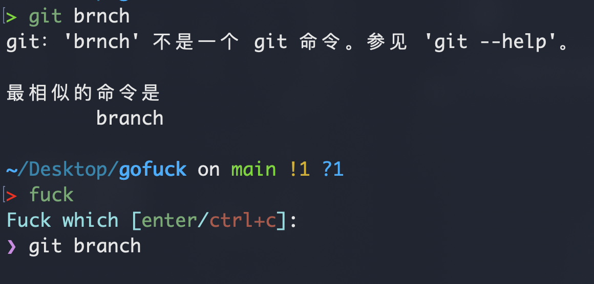
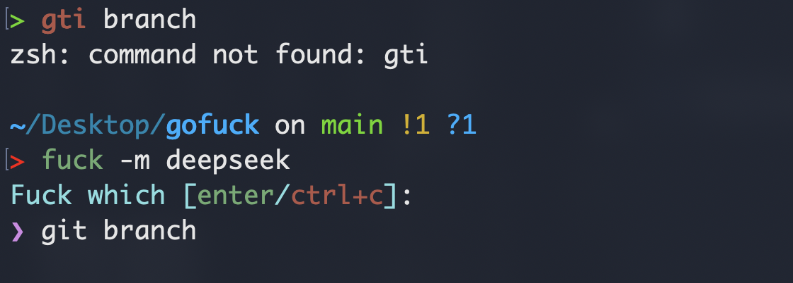
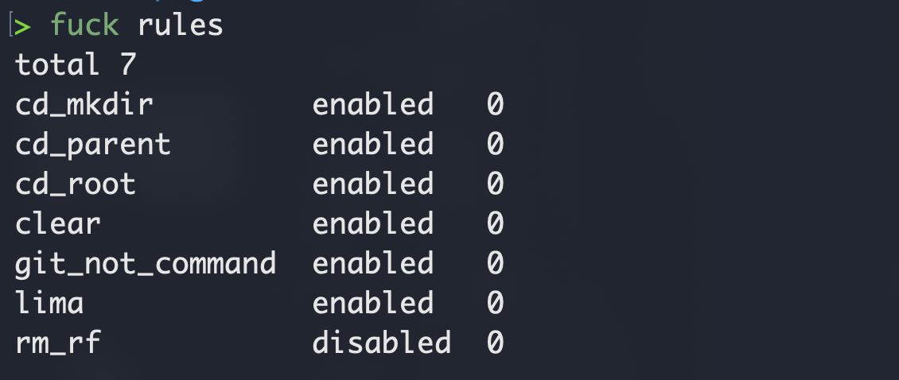

<p align="center">
  
</p>

# gofuck 🐭

<p align="center">
  <a href="LICENSE.md"></a>
  <a href="go.mod"></a>
  <a href="#shell-integration"></a>
</p>

**gofuck** is a Go rewrite of [The Fuck](https://github.com/nvbn/thefuck), a command-line tool that suggests fixes for your previous shell command. It uses built-in correction rules by default and can also ask a configured AI provider for suggestions.

## Example

### Built-in correction

After `git brnch` fails, `fuck` suggests `git branch`.



### AI-assisted correction

After `gti branch` fails, `fuck -m deepseek` suggests `git branch`.



### List correction rules

`fuck rules` shows which rules are enabled and their priorities.



## Installation

Build from the repository root with Go 1.27.3 or later:

```sh
mkdir -p bin
go build -o ./bin/fuck ./cmd/gofuck
```

### Shell integration

**Zsh:** Run `sh install.sh` to install `./bin/fuck` at `~/.local/bin/fuck` and add the integration to `.zshrc`. If you already have a compiled binary, pass its path instead:

```sh
sh install.sh /path/to/fuck
```

For a manual Zsh setup, use `eval "$(command fuck init zsh)"` in `.zshrc` after adding the binary to `PATH`. Open a new shell or reload your startup file to enable the integration. The shell scripts are embedded in the binary.

**Bash:** Put the executable in a directory on your `PATH` and name it `fuck`. Then add this line to the Bash startup file you use, such as `~/.bashrc`:

```bash
eval "$(command fuck init bash)"
```

## Usage

| Command | What it does |
| --- | --- |
| `fuck` | Review the suggested corrections and choose one to run. |
| `fuck -y` | Run the first suggestion without confirmation. |
| `fuck rules` | List the built-in rules, their status, and their priority. |
| `fuck -m deepseek` | Ask the configured provider for suggestions instead of using built-in rules. This mode is more flexible. |

To collect an error message, gofuck reruns the previous command in a subshell and captures its standard error. A command that writes files or changes external state can repeat those effects during capture. The selected correction runs in your current shell.

When AI mode cannot find a direct fix, it can suggest the next command to run, such as a diagnostic command that helps identify the cause of the error.

## Configuration

Built-in rules work without a config file. Use the [example config](config.toml) as a starting point and save your local copy to `~/.config/gofuck/config.toml`, or to `$GOFUCK_CONFIG_HOME/gofuck/config.toml` if you set `GOFUCK_CONFIG_HOME`. When overriding a rule, set `enabled` explicitly; lower priority values are tried first.

For AI suggestions, configure a provider with a base URL, an API key, and a list of models. gofuck uses the first model in the list and sends the previous command and captured standard error to that provider when you use `-m`.

> Note: only support deepseek for now.

## Uninstall

If you used the Zsh installer, run `sh uninstall.sh`. For a manual installation, remove the `eval` line from your startup file and delete the binary you installed. Open a new shell to unload the integration.

## Contributing

See [CONTRIBUTING.md](CONTRIBUTING.md).

## License

[MIT](LICENSE.md).
